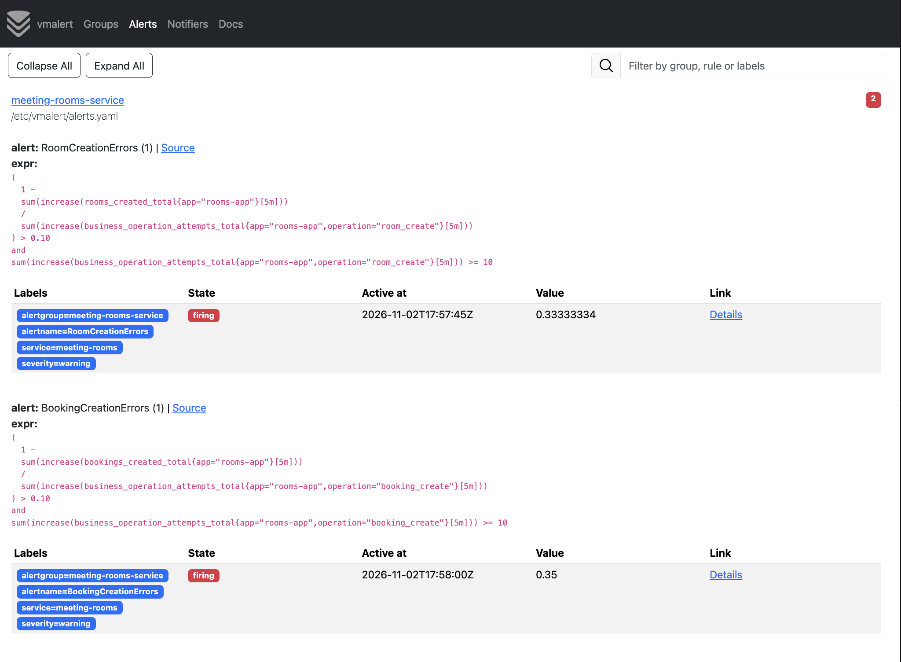
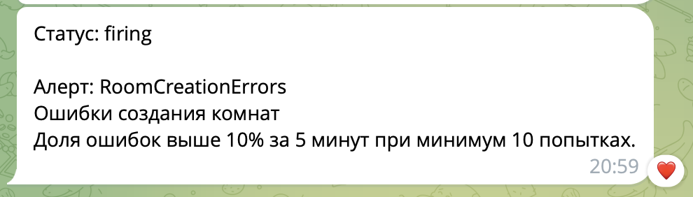
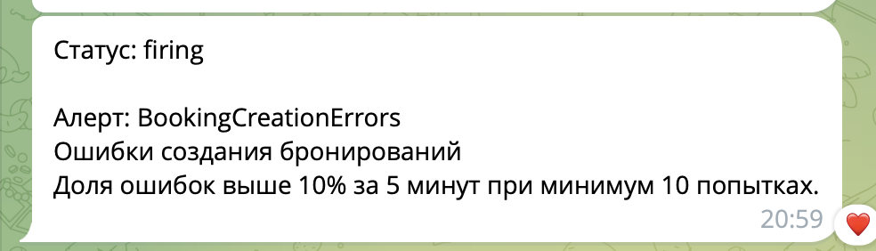
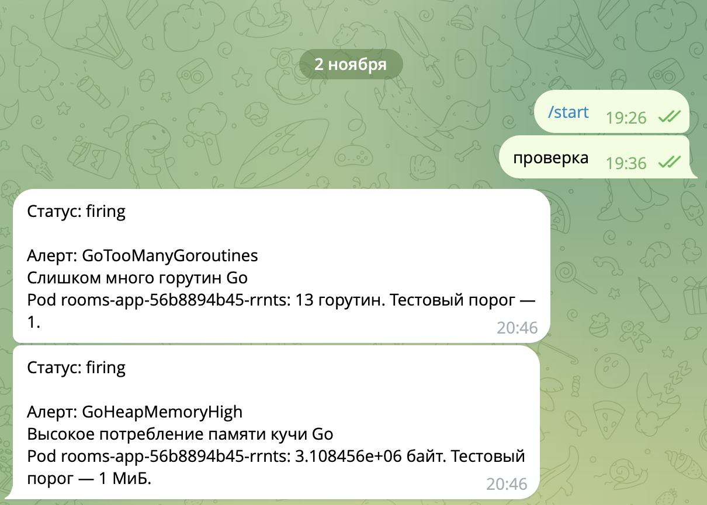
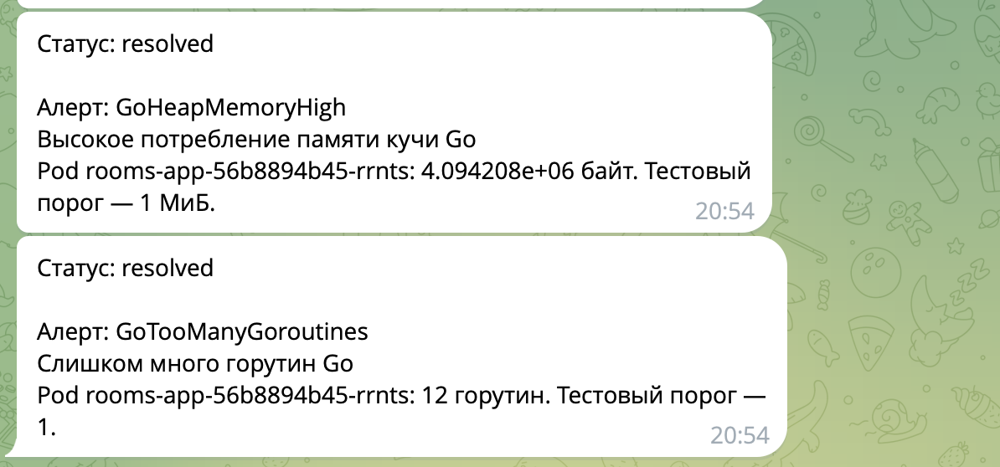

# Мониторинг и алерты сервиса Meeting Rooms

Отчёт по домашнему заданию 1 • 2 ноября 2026 года

Для сервиса создания переговорных комнат и бронирований настроены четыре алерта: два на ошибки бизнес-операций и два на метрики рантайма Go. Правила загружены в vmalert, уведомления о срабатывании всех четырёх алертов получены в Telegram через Alertmanager.

## Схема мониторинга

Приложение rooms-app работает в Kubernetes в пространстве имён meeting-rooms и публикует метрики на /metrics, порт 9090. VictoriaMetrics собирает и хранит метрики, vmalert вычисляет правила каждые 15 секунд и передаёт активные алерты в Alertmanager. Alertmanager группирует уведомления и отправляет их в Telegram.

Поскольку приложение написано на Go, для контроля рантайма использованы go_goroutines и go_memstats_alloc_bytes. Это метрики Go runtime, а не Spring Actuator или Python.

## Выбор условий

- **RoomCreationErrors**. Доля ошибок создания комнат выше 10% за последние 5 минут при минимум 10 учитываемых попытках. Условие должно сохраняться 1 минуту. Алерт выявляет ухудшение основной функции сервиса.

- **BookingCreationErrors**. Аналогичное условие для создания бронирований. Отдельный алерт позволяет определить, какая бизнес-операция работает с ошибками.

- **GoTooManyGoroutines**. Более 100 горутин в течение 2 минут. Рост количества горутин может указывать на зависшие операции, увеличение нагрузки или утечку горутин.

- **GoHeapMemoryHigh**. Более 100 МиБ выделенной памяти кучи Go в течение 2 минут. Алерт позволяет заметить рост памяти; метрика не отражает всю память процесса или контейнера.

Окно 5 минут сглаживает кратковременные колебания, минимум 10 попыток снижает шум при малом трафике, а for защищает от единичных всплесков. Пороги рантайма выбраны как исходные для учебного стенда и требуют калибровки под рабочую нагрузку.

## Проверка алертов сервиса

Для проверки использован режим errors в ConfigMap slo-demo. В этом режиме приложение возвращает HTTP 503 на каждый третий запрос в соответствующих обработчиках. Запросы генерирует rooms-prober. После накопления попыток и выдержки for оба алерта перешли в firing.

На снимке доля ошибок создания комнат составляет около 33,3%, бронирований — 35%. Оба значения превышают порог 10%.



*Рисунок 1 — RoomCreationErrors и BookingCreationErrors в состоянии firing в vmalert.*

Доля ошибок рассчитывается как 1 − число успешных операций / число учитываемых попыток. Счётчик попыток учитывает ответы 2xx и 5xx; клиентские ошибки 4xx исключены. increase вычисляет прирост счётчиков за окно, sum объединяет данные экземпляров приложения.

## Доставка уведомлений

Уведомления о двух бизнес-алертах доставлены в Telegram. В сообщениях указаны статус, имя алерта, описание проблемы и условие срабатывания.





*Рисунок 2 — Уведомления о срабатывании двух алертов сервиса.*

Для проверки алертов Go пороги временно снижены до 1 горутины и 1 МиБ памяти, выдержка for оставлена равной 2 минутам. При 13 горутинах и примерно 3,11 МБ памяти получены оба уведомления. Проверка подтверждает работу правил и доставки; реальная утечка ресурсов не моделировалась.



*Рисунок 3 — Уведомления о срабатывании алертов Go на тестовых порогах.*

## Проверка завершения алертов Go

После проверки восстановлена основная конфигурация с порогами 100 горутин и 100 МиБ. В Telegram получены уведомления resolved для обоих алертов рантайма. Текст с тестовым порогом относится к завершившемуся тестовому событию.



*Рисунок 4 — Уведомления resolved после возврата основных порогов.*

## Размещение конфигурации

Правила хранятся в ConfigMap vmalert-metric-rules и подключены в vmalert как /etc/vmalert/alerts.yaml. Манифесты правил, Deployment и Service находятся в k8s/10-vmalert-metrics.yaml. Конфигурация и манифесты Alertmanager находятся в k8s/09-alertmanager.yaml. В следующих разделах приведено содержимое правил и конфигурации Alertmanager.

Токен бота хранится отдельно в Kubernetes Secret alertmanager-telegram, ключ bot-token, и монтируется в /etc/alertmanager-secrets/bot-token. Секретное значение в отчёт не включено.

## Возврат стенда в обычный режим

После демонстрации бизнес-ошибок необходимо вернуть mode: normal в ConfigMap slo-demo. В предоставленных материалах зафиксировано срабатывание бизнес-алертов; их последующее завершение отдельным скриншотом не подтверждено.

```bash
minikube kubectl -- patch configmap slo-demo \
  -n meeting-rooms --type merge \
  -p '{"data":{"mode":"normal"}}'
```

После обновления конфигурации и выхода ошибок из пятиминутного окна ожидается завершение бизнес-алертов при продолжающемся успешном трафике.

## Конфигурация алертов сервиса

Содержимое alerts.yaml в ConfigMap vmalert-metric-rules. Оба правила имеют метки severity: warning и service: meeting-rooms.

```yaml
groups:
  - name: meeting-rooms-service
    type: prometheus
    interval: 15s
    rules:
      - alert: RoomCreationErrors
        expr: |
          (
            1 -
            sum(increase(rooms_created_total{
              app="rooms-app"}[5m]))
            /
            sum(increase(business_operation_attempts_total{
              app="rooms-app",operation="room_create"}[5m]))
          ) > 0.10
          and
          sum(increase(business_operation_attempts_total{
            app="rooms-app",operation="room_create"}[5m])) >= 10
        for: 1m
        labels:
          severity: warning
          service: meeting-rooms
        annotations:
          summary: Ошибки создания комнат
          description: >-
            Доля ошибок выше 10% за 5 минут
            при минимум 10 попытках.
      - alert: BookingCreationErrors
        expr: |
          (
            1 -
            sum(increase(bookings_created_total{
              app="rooms-app"}[5m]))
            /
            sum(increase(business_operation_attempts_total{
              app="rooms-app",operation="booking_create"}[5m]))
          ) > 0.10
          and
          sum(increase(business_operation_attempts_total{
            app="rooms-app",operation="booking_create"}[5m])) >= 10
        for: 1m
        labels:
          severity: warning
          service: meeting-rooms
        annotations:
          summary: Ошибки создания бронирований
          description: >-
            Доля ошибок выше 10% за 5 минут
            при минимум 10 попытках.
```

## Конфигурация алертов рантайма

Продолжение списка groups в том же alerts.yaml. Ниже приведены основные пороги; при демонстрации использовались временные пороги 1 и 1 МиБ.

```yaml
  - name: meeting-rooms-runtime
    type: prometheus
    interval: 15s
    rules:
      - alert: GoTooManyGoroutines
        expr: go_goroutines{app="rooms-app"} > 100
        for: 2m
        labels:
          severity: warning
          service: meeting-rooms
        annotations:
          summary: Слишком много горутин Go
          description: >-
            Pod {{ $labels.pod }}: {{ $value }} горутин.
            Порог — 100.
      - alert: GoHeapMemoryHigh
        expr: >-
          go_memstats_alloc_bytes{app="rooms-app"}
          > 100 * 1024 * 1024
        for: 2m
        labels:
          severity: warning
          service: meeting-rooms
        annotations:
          summary: Высокое потребление памяти кучи Go
          description: >-
            Pod {{ $labels.pod }}: {{ $value }} байт.
            Порог — 100 МиБ.
```

## Подключение vmalert

Использован vmalert версии v1.136.0. Источник данных — VictoriaMetrics в namespace monitoring; получатель алертов — Alertmanager в namespace meeting-rooms. Параметры контейнера:

```text
-rule=/etc/vmalert/alerts.yaml
-rule.defaultRuleType=prometheus
-datasource.url=http://vm-single-victoria-metrics-single-server.monitoring.svc.cluster.local:8428
-notifier.url=http://alertmanager.meeting-rooms.svc.cluster.local:9093
-httpListenAddr=:8880
```

## Конфигурация Alertmanager

Alertmanager версии 0.28.1 использует следующую конфигурацию из /etc/alertmanager/alertmanager.yaml. Канал Telegram выбран для получения скриншотов уведомлений о срабатывании и завершении алертов.

```yaml
route:
  receiver: telegram
  group_by: [alertname, service]
  group_wait: 5s
  group_interval: 15s
  repeat_interval: 1h
receivers:
  - name: telegram
    telegram_configs:
      - bot_token_file: /etc/alertmanager-secrets/bot-token
        chat_id: 1415300064
        send_resolved: true
        parse_mode: ""
        message: |
          Статус: {{ .Status }}
          {{ range .Alerts }}
          Алерт: {{ .Labels.alertname }}
          {{ .Annotations.summary }}
          {{ .Annotations.description }}
          {{ end }}
```

Группировка по имени алерта и сервису разделяет разные проблемы. Начальное ожидание 5 секунд и интервал обновления 15 секунд удобны для учебной демонстрации. Повторное уведомление об остающейся проблеме отправляется через 1 час. send_resolved включает сообщения о завершении.

## Результат работы

Созданы два алерта на метрики сервиса и два на метрики рантайма Go. Срабатывание бизнес-алертов подтверждено интерфейсом vmalert и уведомлениями Telegram. Для алертов рантайма подтверждены firing на сниженных тестовых порогах и последующие resolved после восстановления основной конфигурации.

Таким образом, проверена цепочка сбора метрик, вычисления правил и доставки уведомлений. Приложенные скриншоты показывают наблюдаемые результаты, а конфигурации позволяют воспроизвести выбранные условия мониторинга.
