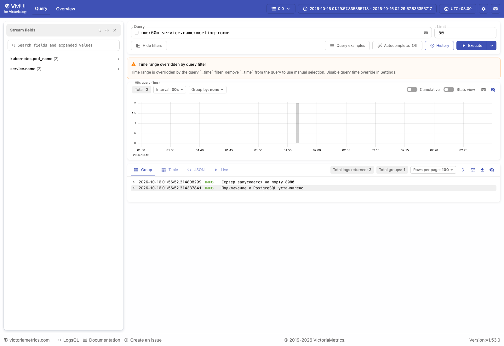
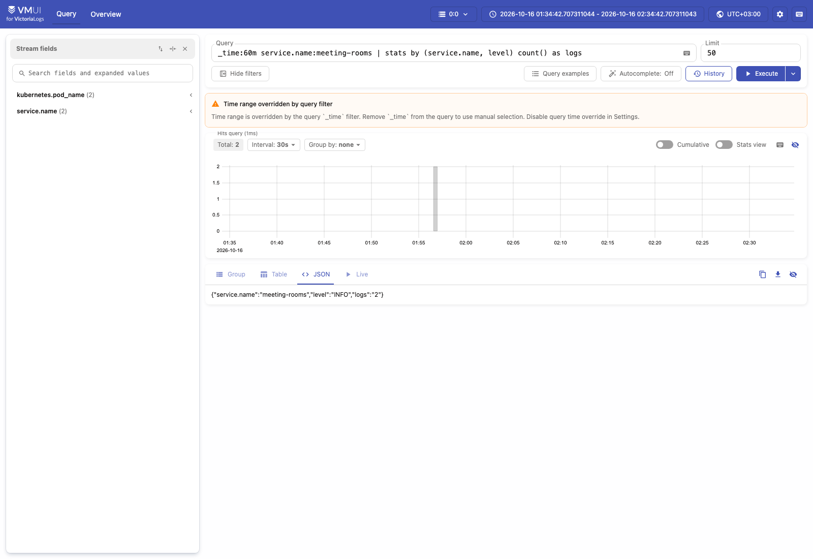
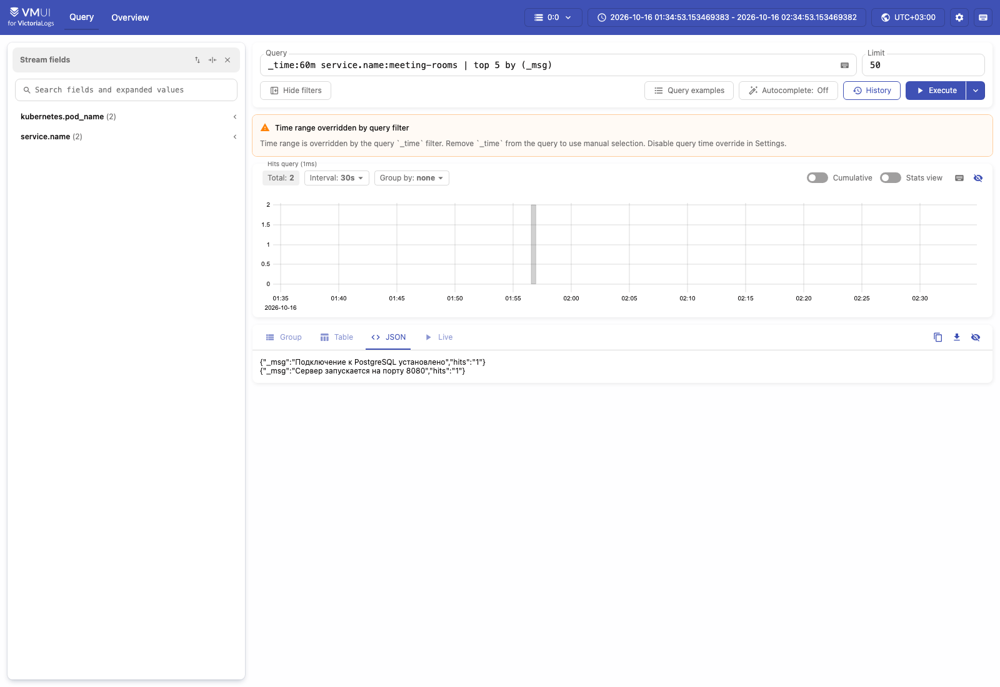

# Отчёт: доставка логов приложения в VictoriaLogs

Приложение Roomly, VictoriaLogs single-node и сборщик Vector развёрнуты
в одном minikube-кластере, в namespace `meeting-rooms`.
Скриншоты сделаны 16 октября 2026 года около 02:30–02:35 МСК.

## Способ доставки логов

Для доставки используется **Vector в виде DaemonSet**. Он читает stdout
контейнеров из файлов логов на узле Kubernetes, выбирает поды с меткой
`app=rooms-app` в namespace `meeting-rooms`, разбирает JSON и отправляет
события в VictoriaLogs через HTTP-эндпоинт `/insert/jsonline`.

```text
Приложение → stdout → файлы логов Kubernetes → Vector → VictoriaLogs → vmui
```

Этот способ выбран потому, что приложение может писать логи в stdout,
не обращаясь к хранилищу напрямую. Один экземпляр Vector на узле собирает
логи подходящих подов и добавляет Kubernetes-метаданные: имя пода,
контейнера и namespace. Конфигурация доставки хранится отдельно от кода
приложения, а DaemonSet обеспечивает запуск сборщика на каждом подходящем
узле кластера.

Приложение использует JSON-логирование с полями `timestamp`, `level`,
`message` и `service.name`. Пример настоящей записи stdout:

```json
{"timestamp":"2026-10-15T22:56:52.214808299Z","level":"INFO","message":"Сервер запускается на порту 8080","service.name":"meeting-rooms"}
```

При приёме данных VictoriaLogs использует `timestamp` как `_time`,
а `message` как `_msg`. Поля `level` и `service.name` доступны для фильтрации
и группировки.

Манифест VictoriaLogs: [k8s/06-victoria-logs.yaml](k8s/06-victoria-logs.yaml).
Конфигурация Vector и DaemonSet: [k8s/07-vector.yaml](k8s/07-vector.yaml).

## Доступ к vmui

```bash
kubectl --context minikube -n meeting-rooms port-forward svc/victoria-logs 9428:9428
```

Адрес интерфейса установленной версии VictoriaLogs `v1.53.0`:
**http://localhost:9428/select/vmui/**.

Все четыре запроса выполнены в поле Query кнопкой Execute.
Использовано окно **последние 60 минут** относительно момента выполнения.
На скриншотах время отображается в UTC+03:00. Уведомление
`Time range overridden by query filter` означает, что интервал задан
условием `_time:60m` в запросе.

## 1. Сырые записи за последние 60 минут

```logsql
_time:60m service.name:meeting-rooms
```

Запрос показывает записи сервиса `meeting-rooms` за последний час
без агрегации. Получены два события: успешное подключение к PostgreSQL
и запуск HTTP-сервера. Их наличие в vmui подтверждает доставку логов
приложения в VictoriaLogs.

Основные поля полученных JSON-записей (остальные Kubernetes-метаданные
для краткости опущены):

```json
[
  {
    "_time": "2026-10-15T22:56:52.214808299Z",
    "level": "INFO",
    "_msg": "Сервер запускается на порту 8080",
    "service.name": "meeting-rooms",
    "kubernetes.pod_name": "rooms-app-6dc5b5786b-d4w94",
    "stream": "stdout"
  },
  {
    "_time": "2026-10-15T22:56:52.214337841Z",
    "level": "INFO",
    "_msg": "Подключение к PostgreSQL установлено",
    "service.name": "meeting-rooms",
    "kubernetes.pod_name": "rooms-app-6dc5b5786b-d4w94",
    "stream": "stdout"
  }
]
```



## 2. Фильтр по полю level

```logsql
_time:60m service.name:meeting-rooms level:INFO
```

Запрос выбирает информационные события по полю `level` со значением `INFO`.
Получены две записи: оба события в выбранном интервале имеют этот уровень.
Такой фильтр позволяет выбирать сообщения нужной серьёзности.

Основные поля результата фильтрации (остальные метаданные опущены):

```json
[
  {
    "_time": "2026-10-15T22:56:52.214808299Z",
    "level": "INFO",
    "_msg": "Сервер запускается на порту 8080",
    "service.name": "meeting-rooms"
  },
  {
    "_time": "2026-10-15T22:56:52.214337841Z",
    "level": "INFO",
    "_msg": "Подключение к PostgreSQL установлено",
    "service.name": "meeting-rooms"
  }
]
```


## 3. Stats с группировкой по сервису и уровню

```logsql
_time:60m service.name:meeting-rooms | stats by (service.name, level) count() as logs
```

Запрос группирует события по имени сервиса и уровню, затем считает записи
в каждой группе. Получена одна группа: сервис `meeting-rooms`, уровень
`INFO`, количество событий `2`. Такая статистика позволяет сравнивать
число сообщений разных уровней внутри сервиса.

Результат в JSON-представлении vmui:

```json
{
  "service.name": "meeting-rooms",
  "level": "INFO",
  "logs": "2"
}
```



## 4. Агрегирующий запрос top

```logsql
_time:60m service.name:meeting-rooms | top 5 by (_msg)
```

Запрос находит пять наиболее частых текстов сообщений. Поле `hits`
содержит число появлений каждого текста. Такой запрос помогает выявлять
повторяющиеся события и наиболее частые ошибки.

В проверенном интервале найдены два разных сообщения, каждое встретилось
один раз:

```json
[
  {
    "_msg": "Подключение к PostgreSQL установлено",
    "hits": "1"
  },
  {
    "_msg": "Сервер запускается на порту 8080",
    "hits": "1"
  }
]
```



Все результаты относятся к моменту создания скриншотов: относительное
окно `_time:60m` при повторном выполнении сдвигается.
Ответы API и состояние кластера сохранены в [docs/evidence](docs/evidence/).
Отчёт следует передавать вместе с каталогом `docs`, содержащим скриншоты.
Для просмотра и передачи одним файлом подготовлена [HTML-версия отчёта](Отчёт.html)
со встроенными изображениями и JSON-результатами.
