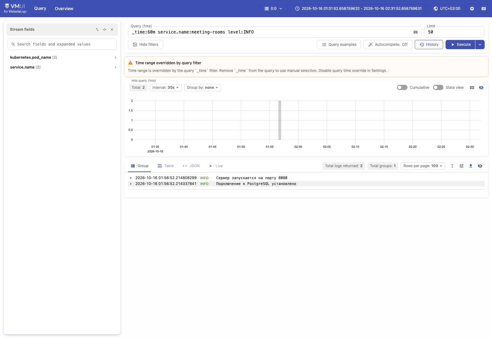
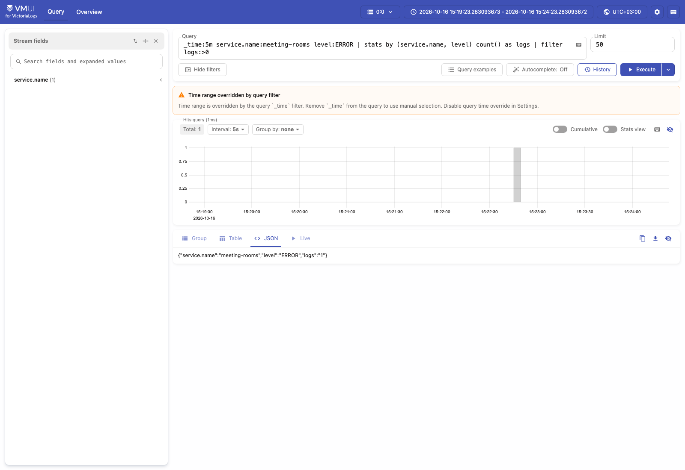
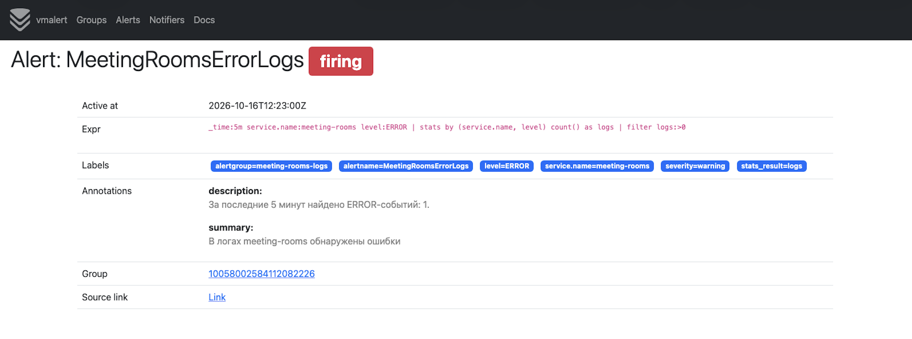
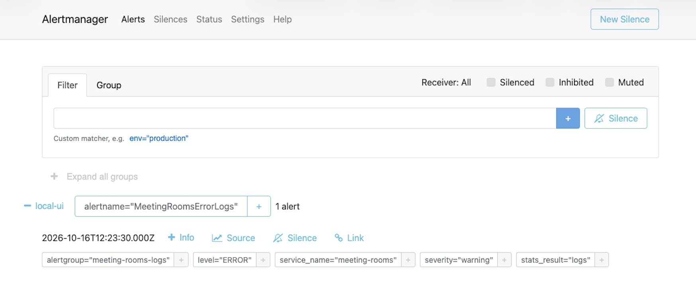

# Отчёт: доставка логов приложения в VictoriaLogs

Приложение Roomly, VictoriaLogs single-node и сборщик Vector развёрнуты
в одном minikube-кластере, в namespace `meeting-rooms`.
Скриншоты сделаны 16 октября 2026 года около 02:30–02:35 МСК.

## Способ доставки логов

Для доставки используется **Vector в виде DaemonSet**. Он читает stdout
контейнеров из файлов логов на узле Kubernetes, выбирает поды с меткой
`app=rooms-app` в namespace `meeting-rooms`, разбирает JSON и отправляет
события в VictoriaLogs через HTTP-эндпоинт `/insert/jsonline`.

```text
Приложение → stdout → файлы логов Kubernetes → Vector → VictoriaLogs → vmui
```

Этот способ выбран потому, что приложение может писать логи в stdout,
не обращаясь к хранилищу напрямую. Один экземпляр Vector на узле собирает
логи подходящих подов и добавляет Kubernetes-метаданные: имя пода,
контейнера и namespace. Конфигурация доставки хранится отдельно от кода
приложения, а DaemonSet обеспечивает запуск сборщика на каждом подходящем
узле кластера.

Приложение использует JSON-логирование с полями `timestamp`, `level`,
`message` и `service.name`. Пример настоящей записи stdout:

```json
{"timestamp":"2026-10-15T22:56:52.214808299Z","level":"INFO","message":"Сервер запускается на порту 8080","service.name":"meeting-rooms"}
```

При приёме данных VictoriaLogs использует `timestamp` как `_time`,
а `message` как `_msg`. Поля `level` и `service.name` доступны для фильтрации
и группировки.

Манифест VictoriaLogs: [k8s/06-victoria-logs.yaml](k8s/06-victoria-logs.yaml).
Конфигурация Vector и DaemonSet: [k8s/07-vector.yaml](k8s/07-vector.yaml).

## Доступ к vmui

```bash
kubectl --context minikube -n meeting-rooms port-forward svc/victoria-logs 9428:9428
```

Адрес интерфейса установленной версии VictoriaLogs `v1.53.0`:
**http://localhost:9428/select/vmui/**.

Все четыре запроса выполнены в поле Query кнопкой Execute.
Использовано окно **последние 60 минут** относительно момента выполнения.
На скриншотах время отображается в UTC+03:00. Уведомление
`Time range overridden by query filter` означает, что интервал задан
условием `_time:60m` в запросе.

## 1. Сырые записи за последние 60 минут

```logsql
_time:60m service.name:meeting-rooms
```

Запрос показывает записи сервиса `meeting-rooms` за последний час
без агрегации. Получены два события: успешное подключение к PostgreSQL
и запуск HTTP-сервера. Их наличие в vmui подтверждает доставку логов
приложения в VictoriaLogs.

Полный ответ запроса (JSON-записи объединены в массив для удобства чтения):

```json
[
  {
    "_msg": "Сервер запускается на порту 8080",
    "_stream": "{kubernetes.pod_name=\"rooms-app-6dc5b5786b-d4w94\",service.name=\"meeting-rooms\"}",
    "_stream_id": "00000000000000009c8c0b61b9993fae567b418923ea3a6b",
    "_time": "2026-10-15T22:56:52.214808299Z",
    "file": "/var/log/pods/meeting-rooms_rooms-app-6dc5b5786b-d4w94_41f5b7a8-dc5d-484e-852d-9bd4ddf22ba6/app/0.log",
    "kubernetes.container_id": "docker://39d5eddb84c469310e0d52bbda8487aa5f6e68e6178922f7585356d38f45ebfb",
    "kubernetes.container_image": "meeting-rooms:v2",
    "kubernetes.container_image_id": "docker://sha256:f966f4a359fb5ad47a34800e7d1a2deb0d10d5f2ab3242bffedaa719cacce826",
    "kubernetes.container_name": "app",
    "kubernetes.namespace_labels.kubernetes.io/metadata.name": "meeting-rooms",
    "kubernetes.node_labels.beta.kubernetes.io/arch": "arm64",
    "kubernetes.node_labels.beta.kubernetes.io/os": "linux",
    "kubernetes.node_labels.kubernetes.io/arch": "arm64",
    "kubernetes.node_labels.kubernetes.io/hostname": "minikube",
    "kubernetes.node_labels.kubernetes.io/os": "linux",
    "kubernetes.node_labels.minikube.k8s.io/commit": "7a9f6a841470a207de8cf4bafcccee0969d8ba10",
    "kubernetes.node_labels.minikube.k8s.io/name": "minikube",
    "kubernetes.node_labels.minikube.k8s.io/primary": "true",
    "kubernetes.node_labels.minikube.k8s.io/updated_at": "2026_10_07T22_33_06_0700",
    "kubernetes.node_labels.minikube.k8s.io/version": "v1.39.0",
    "kubernetes.pod_annotations.kubectl.kubernetes.io/restartedAt": "2026-10-16T01:56:51+03:00",
    "kubernetes.pod_ip": "10.244.0.30",
    "kubernetes.pod_ips": "[\"10.244.0.30\"]",
    "kubernetes.pod_labels.app": "rooms-app",
    "kubernetes.pod_labels.pod-template-hash": "6dc5b5786b",
    "kubernetes.pod_name": "rooms-app-6dc5b5786b-d4w94",
    "kubernetes.pod_namespace": "meeting-rooms",
    "kubernetes.pod_node_name": "minikube",
    "kubernetes.pod_owner": "ReplicaSet/rooms-app-6dc5b5786b",
    "kubernetes.pod_uid": "41f5b7a8-dc5d-484e-852d-9bd4ddf22ba6",
    "level": "INFO",
    "service.name": "meeting-rooms",
    "source_type": "kubernetes_logs",
    "stream": "stdout"
  },
  {
    "_msg": "Подключение к PostgreSQL установлено",
    "_stream": "{kubernetes.pod_name=\"rooms-app-6dc5b5786b-d4w94\",service.name=\"meeting-rooms\"}",
    "_stream_id": "00000000000000009c8c0b61b9993fae567b418923ea3a6b",
    "_time": "2026-10-15T22:56:52.214337841Z",
    "file": "/var/log/pods/meeting-rooms_rooms-app-6dc5b5786b-d4w94_41f5b7a8-dc5d-484e-852d-9bd4ddf22ba6/app/0.log",
    "kubernetes.container_id": "docker://39d5eddb84c469310e0d52bbda8487aa5f6e68e6178922f7585356d38f45ebfb",
    "kubernetes.container_image": "meeting-rooms:v2",
    "kubernetes.container_image_id": "docker://sha256:f966f4a359fb5ad47a34800e7d1a2deb0d10d5f2ab3242bffedaa719cacce826",
    "kubernetes.container_name": "app",
    "kubernetes.namespace_labels.kubernetes.io/metadata.name": "meeting-rooms",
    "kubernetes.node_labels.beta.kubernetes.io/arch": "arm64",
    "kubernetes.node_labels.beta.kubernetes.io/os": "linux",
    "kubernetes.node_labels.kubernetes.io/arch": "arm64",
    "kubernetes.node_labels.kubernetes.io/hostname": "minikube",
    "kubernetes.node_labels.kubernetes.io/os": "linux",
    "kubernetes.node_labels.minikube.k8s.io/commit": "7a9f6a841470a207de8cf4bafcccee0969d8ba10",
    "kubernetes.node_labels.minikube.k8s.io/name": "minikube",
    "kubernetes.node_labels.minikube.k8s.io/primary": "true",
    "kubernetes.node_labels.minikube.k8s.io/updated_at": "2026_10_07T22_33_06_0700",
    "kubernetes.node_labels.minikube.k8s.io/version": "v1.39.0",
    "kubernetes.pod_annotations.kubectl.kubernetes.io/restartedAt": "2026-10-16T01:56:51+03:00",
    "kubernetes.pod_ip": "10.244.0.30",
    "kubernetes.pod_ips": "[\"10.244.0.30\"]",
    "kubernetes.pod_labels.app": "rooms-app",
    "kubernetes.pod_labels.pod-template-hash": "6dc5b5786b",
    "kubernetes.pod_name": "rooms-app-6dc5b5786b-d4w94",
    "kubernetes.pod_namespace": "meeting-rooms",
    "kubernetes.pod_node_name": "minikube",
    "kubernetes.pod_owner": "ReplicaSet/rooms-app-6dc5b5786b",
    "kubernetes.pod_uid": "41f5b7a8-dc5d-484e-852d-9bd4ddf22ba6",
    "level": "INFO",
    "service.name": "meeting-rooms",
    "source_type": "kubernetes_logs",
    "stream": "stdout"
  }
]
```


## 2. Фильтр по полю level

```logsql
_time:60m service.name:meeting-rooms level:INFO
```

Запрос выбирает информационные события по полю `level` со значением `INFO`.
Получены две записи: оба события в выбранном интервале имеют этот уровень.
Такой фильтр позволяет выбирать сообщения нужной серьёзности.

Полный ответ запроса (JSON-записи объединены в массив для удобства чтения):

```json
[
  {
    "_msg": "Сервер запускается на порту 8080",
    "_stream": "{kubernetes.pod_name=\"rooms-app-6dc5b5786b-d4w94\",service.name=\"meeting-rooms\"}",
    "_stream_id": "00000000000000009c8c0b61b9993fae567b418923ea3a6b",
    "_time": "2026-10-15T22:56:52.214808299Z",
    "file": "/var/log/pods/meeting-rooms_rooms-app-6dc5b5786b-d4w94_41f5b7a8-dc5d-484e-852d-9bd4ddf22ba6/app/0.log",
    "kubernetes.container_id": "docker://39d5eddb84c469310e0d52bbda8487aa5f6e68e6178922f7585356d38f45ebfb",
    "kubernetes.container_image": "meeting-rooms:v2",
    "kubernetes.container_image_id": "docker://sha256:f966f4a359fb5ad47a34800e7d1a2deb0d10d5f2ab3242bffedaa719cacce826",
    "kubernetes.container_name": "app",
    "kubernetes.namespace_labels.kubernetes.io/metadata.name": "meeting-rooms",
    "kubernetes.node_labels.beta.kubernetes.io/arch": "arm64",
    "kubernetes.node_labels.beta.kubernetes.io/os": "linux",
    "kubernetes.node_labels.kubernetes.io/arch": "arm64",
    "kubernetes.node_labels.kubernetes.io/hostname": "minikube",
    "kubernetes.node_labels.kubernetes.io/os": "linux",
    "kubernetes.node_labels.minikube.k8s.io/commit": "7a9f6a841470a207de8cf4bafcccee0969d8ba10",
    "kubernetes.node_labels.minikube.k8s.io/name": "minikube",
    "kubernetes.node_labels.minikube.k8s.io/primary": "true",
    "kubernetes.node_labels.minikube.k8s.io/updated_at": "2026_10_07T22_33_06_0700",
    "kubernetes.node_labels.minikube.k8s.io/version": "v1.39.0",
    "kubernetes.pod_annotations.kubectl.kubernetes.io/restartedAt": "2026-10-16T01:56:51+03:00",
    "kubernetes.pod_ip": "10.244.0.30",
    "kubernetes.pod_ips": "[\"10.244.0.30\"]",
    "kubernetes.pod_labels.app": "rooms-app",
    "kubernetes.pod_labels.pod-template-hash": "6dc5b5786b",
    "kubernetes.pod_name": "rooms-app-6dc5b5786b-d4w94",
    "kubernetes.pod_namespace": "meeting-rooms",
    "kubernetes.pod_node_name": "minikube",
    "kubernetes.pod_owner": "ReplicaSet/rooms-app-6dc5b5786b",
    "kubernetes.pod_uid": "41f5b7a8-dc5d-484e-852d-9bd4ddf22ba6",
    "level": "INFO",
    "service.name": "meeting-rooms",
    "source_type": "kubernetes_logs",
    "stream": "stdout"
  },
  {
    "_msg": "Подключение к PostgreSQL установлено",
    "_stream": "{kubernetes.pod_name=\"rooms-app-6dc5b5786b-d4w94\",service.name=\"meeting-rooms\"}",
    "_stream_id": "00000000000000009c8c0b61b9993fae567b418923ea3a6b",
    "_time": "2026-10-15T22:56:52.214337841Z",
    "file": "/var/log/pods/meeting-rooms_rooms-app-6dc5b5786b-d4w94_41f5b7a8-dc5d-484e-852d-9bd4ddf22ba6/app/0.log",
    "kubernetes.container_id": "docker://39d5eddb84c469310e0d52bbda8487aa5f6e68e6178922f7585356d38f45ebfb",
    "kubernetes.container_image": "meeting-rooms:v2",
    "kubernetes.container_image_id": "docker://sha256:f966f4a359fb5ad47a34800e7d1a2deb0d10d5f2ab3242bffedaa719cacce826",
    "kubernetes.container_name": "app",
    "kubernetes.namespace_labels.kubernetes.io/metadata.name": "meeting-rooms",
    "kubernetes.node_labels.beta.kubernetes.io/arch": "arm64",
    "kubernetes.node_labels.beta.kubernetes.io/os": "linux",
    "kubernetes.node_labels.kubernetes.io/arch": "arm64",
    "kubernetes.node_labels.kubernetes.io/hostname": "minikube",
    "kubernetes.node_labels.kubernetes.io/os": "linux",
    "kubernetes.node_labels.minikube.k8s.io/commit": "7a9f6a841470a207de8cf4bafcccee0969d8ba10",
    "kubernetes.node_labels.minikube.k8s.io/name": "minikube",
    "kubernetes.node_labels.minikube.k8s.io/primary": "true",
    "kubernetes.node_labels.minikube.k8s.io/updated_at": "2026_10_07T22_33_06_0700",
    "kubernetes.node_labels.minikube.k8s.io/version": "v1.39.0",
    "kubernetes.pod_annotations.kubectl.kubernetes.io/restartedAt": "2026-10-16T01:56:51+03:00",
    "kubernetes.pod_ip": "10.244.0.30",
    "kubernetes.pod_ips": "[\"10.244.0.30\"]",
    "kubernetes.pod_labels.app": "rooms-app",
    "kubernetes.pod_labels.pod-template-hash": "6dc5b5786b",
    "kubernetes.pod_name": "rooms-app-6dc5b5786b-d4w94",
    "kubernetes.pod_namespace": "meeting-rooms",
    "kubernetes.pod_node_name": "minikube",
    "kubernetes.pod_owner": "ReplicaSet/rooms-app-6dc5b5786b",
    "kubernetes.pod_uid": "41f5b7a8-dc5d-484e-852d-9bd4ddf22ba6",
    "level": "INFO",
    "service.name": "meeting-rooms",
    "source_type": "kubernetes_logs",
    "stream": "stdout"
  }
]
```



## 3. Stats с группировкой по сервису и уровню

```logsql
_time:60m service.name:meeting-rooms | stats by (service.name, level) count() as logs
```

Запрос группирует события по имени сервиса и уровню, затем считает записи
в каждой группе. Получена одна группа: сервис `meeting-rooms`, уровень
`INFO`, количество событий `2`. Такая статистика позволяет сравнивать
число сообщений разных уровней внутри сервиса.

Результат в JSON-представлении vmui:

```json
{
  "service.name": "meeting-rooms",
  "level": "INFO",
  "logs": "2"
}
```


## 4. Агрегирующий запрос top

```logsql
_time:60m service.name:meeting-rooms | top 5 by (_msg)
```

Запрос находит пять наиболее частых текстов сообщений. Поле `hits`
содержит число появлений каждого текста. Такой запрос помогает выявлять
повторяющиеся события и наиболее частые ошибки.

В проверенном интервале найдены два разных сообщения, каждое встретилось
один раз:

```json
[
  {
    "_msg": "Подключение к PostgreSQL установлено",
    "hits": "1"
  },
  {
    "_msg": "Сервер запускается на порту 8080",
    "hits": "1"
  }
]
```


Все результаты относятся к моменту создания скриншотов: относительное
окно `_time:60m` при повторном выполнении сдвигается.
Отчёт следует передавать вместе с каталогом `screenshots`, содержащим скриншоты.

## 5. Бонус: алерт по логам через vmalert

В тот же namespace `meeting-rooms` развёрнуты **vmalert v1.136.0**
и **Alertmanager v0.28.1**. vmalert выполняет LogsQL-запрос к VictoriaLogs
и передаёт сработавший алерт в Alertmanager. Для группы правил указан
`type: vlogs`, как описано в
[официальной инструкции VictoriaLogs](https://docs.victoriametrics.com/victorialogs/vmalert/).

Правило `MeetingRoomsErrorLogs` основано на запросе №3: подсчёте событий
с группировкой по сервису и уровню. Добавлены фильтр `level:ERROR`,
окно пять минут и порог `logs:>0`:

```logsql
_time:5m service.name:meeting-rooms level:ERROR | stats by (service.name, level) count() as logs | filter logs:>0
```

Запрос выполняется каждые **15 секунд**. Если за последние пять минут
есть хотя бы одна ошибка и условие сохраняется **30 секунд** (`for: 30s`),
алерт переходит из `pending` в `firing`. Уровень алерта — `warning`.
При исчезновении ошибок из окна он возвращается в `inactive`.
Правило учитывает именно поле `level:ERROR`; сообщения, записанные
стандартным `log.Printf` с уровнем `INFO`, под него не попадают.

Манифесты:

- [k8s/08-vmalert.yaml](k8s/08-vmalert.yaml) — правило, Deployment и Service vmalert.
- [k8s/09-alertmanager.yaml](k8s/09-alertmanager.yaml) — конфигурация, Deployment и Service Alertmanager.

Развёртывание:

```bash
kubectl --context minikube apply -f k8s/09-alertmanager.yaml -f k8s/08-vmalert.yaml
kubectl --context minikube -n meeting-rooms rollout status deployment/alertmanager
kubectl --context minikube -n meeting-rooms rollout status deployment/vmalert
```

Доступ к интерфейсам — в отдельных терминалах:

```bash
kubectl --context minikube -n meeting-rooms port-forward svc/vmalert 8880:8880
```

```bash
kubectl --context minikube -n meeting-rooms port-forward svc/alertmanager 9093:9093
```

Интерфейс правил: **http://localhost:8880/vmalert/groups**.
Полученные алерты: **http://localhost:9093/#/alerts**.
Alertmanager принимает алерты для локального просмотра; отправка в Telegram,
почту или другие внешние каналы не настроена. История состояний vmalert
не сохраняется через remote write, данные Alertmanager используют `emptyDir`.

### Проверка срабатывания

Проверка выполнена **16 октября 2026 года в 15:23:38 МСК**.
До теста правило имело состояние `inactive`, `health: ok` и пустой `lastError`.
Для воспроизводимой проверки подготовлен
[scripts/test-log-alert.mjs](scripts/test-log-alert.mjs).
При работающих port-forward к VictoriaLogs, vmalert и Alertmanager:

```bash
node scripts/test-log-alert.mjs
```

Скрипт отправляет **одну синтетическую запись напрямую в VictoriaLogs**,
затем проверяет `firing` в API vmalert и получение алерта в API Alertmanager.
Эта запись проверяет цепочку алертинга, а доставка реальных логов через
Vector подтверждена в основных разделах отчёта. Тестовое событие явно помечено:

```json
{
  "timestamp": "2026-10-16T12:22:48.198Z",
  "level": "ERROR",
  "message": "Synthetic error for the homework vmalert smoke test",
  "service.name": "meeting-rooms",
  "source": "bonus-smoke-test",
  "test": true
}
```

При повторном запуске скрипт автоматически использует текущее время.
Наблюдался переход **inactive → pending → firing**. Результат запроса в vmui:

```json
{
  "service.name": "meeting-rooms",
  "level": "ERROR",
  "logs": "1"
}
```



Основные поля ответа API vmalert `/api/v1/rules` на момент проверки:

```json
{
  "name": "MeetingRoomsErrorLogs",
  "state": "firing",
  "health": "ok",
  "lastError": "",
  "datasourceType": "vlogs",
  "lastSamples": 1
}
```



Alertmanager принял алерт `MeetingRoomsErrorLogs` со статусом `active`,
уровнем `warning` и описанием «За последние 5 минут найдено ERROR-событий: 1».
Получатель — `local-ui`. Метка `service.name` при передаче в Alertmanager
нормализуется в `service_name`.



Тестовая запись выходит из пятиминутного окна автоматически. Повторный запуск
теста создаёт новое событие и снова проверяет срабатывание; при наличии
нескольких событий счётчик будет больше единицы.
